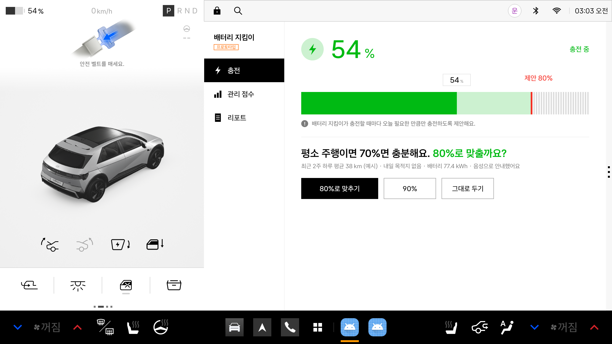
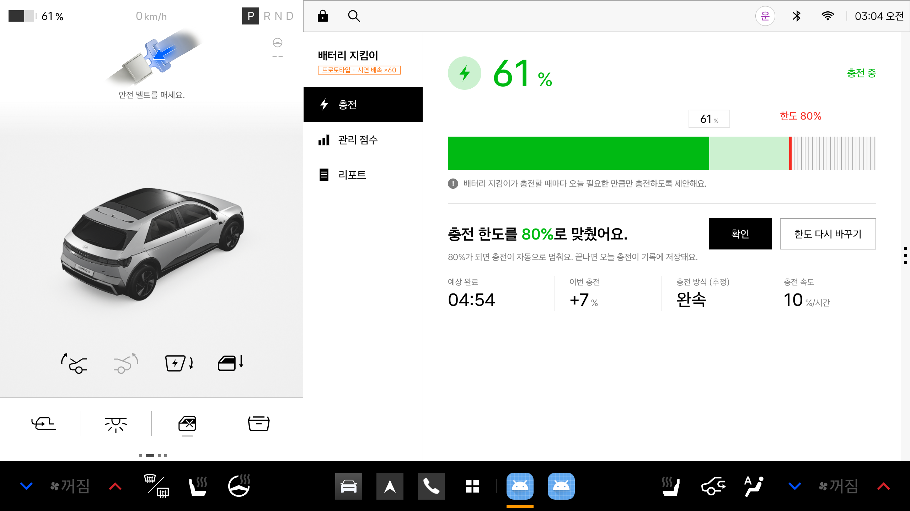
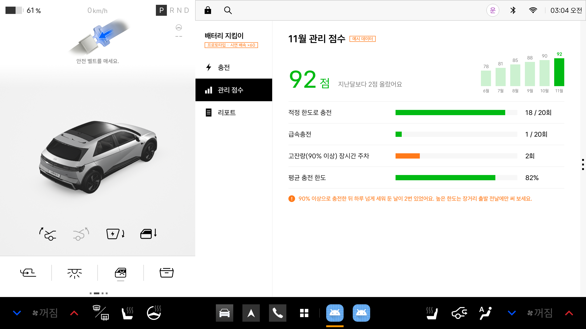
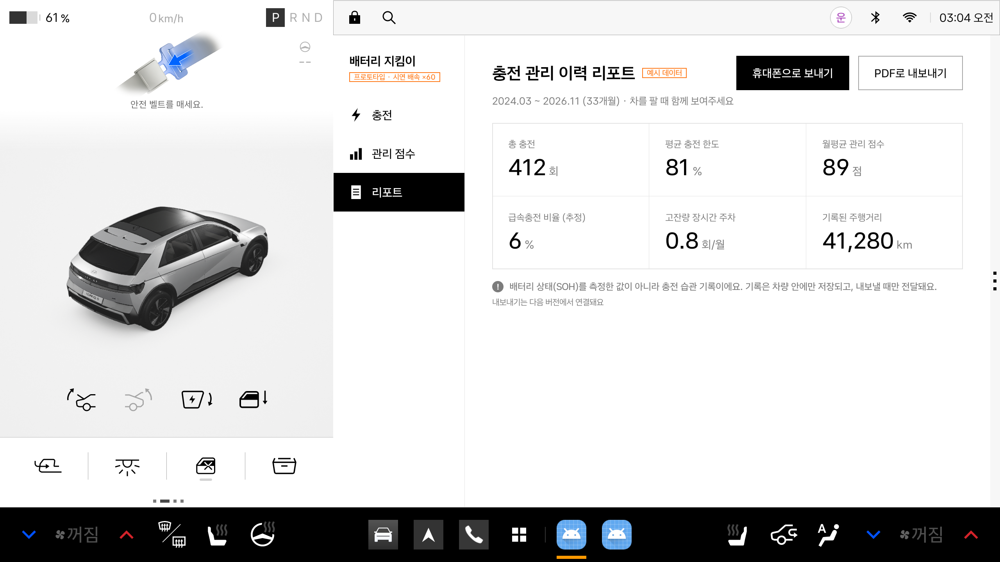
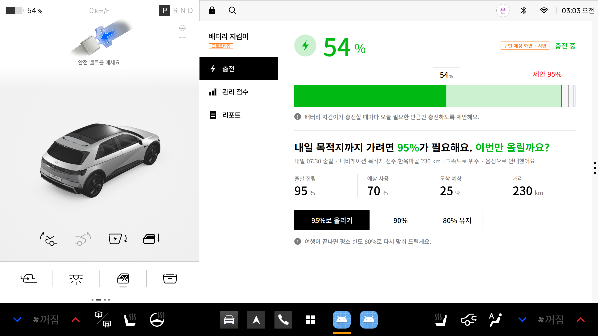

# 배터리 지킴이 (Battery Guard)

**충전하는 그 순간 차가 직접 배터리를 지켜 주고, 차를 팔 때 그 관리 이력으로 제값을 받도록 돕는 전기차 잔존가치 코치**

현대자동차그룹 차량용 앱 개발 공모전 출품작 · Pleos Connect 앱 · **프로토타입**

- 시연 영상: https://youtu.be/a1jNlTQGhAo
- APK: [`apk/지승현_배터리지킴이_release.apk`](apk/%EC%A7%80%EC%8A%B9%ED%98%84_%EB%B0%B0%ED%84%B0%EB%A6%AC%EC%A7%80%ED%82%B4%EC%9D%B4_release.apk)



---

## 1. 무엇을 하나요?

충전기를 꽂으면 앱이 평소 주행 패턴을 보고 **오늘 필요한 만큼만** 충전하도록 제안하고, 승인 한 번으로 **차량 충전 한도를 바로 바꿉니다.**

| 기능 | 상태 | 사용 SDK / API |
|---|---|---|
| 충전기 연결 감지 | ✅ 구현 | Vehicle SDK `EvBattery.registerEvChargePortOpen`, `getEvChargeSwitchState` |
| 실시간 잔량 표시 | ✅ 구현 | Vehicle SDK `EvBattery.registerEvBatteryStateOfCharge` |
| 상황 맞춤 충전 한도 제안 + 음성 안내 | ✅ 구현 | 앱 내부 계산 + TextToSpeech SDK (온디바이스, ko-KR) |
| 승인 시 차량 충전 한도 적용 | ✅ 구현 | Vehicle SDK `EvBattery.setEvChargePercentLimit` |
| 급속·완속 추정 (잔량 상승 속도 기준) | ✅ 구현 | 앱 내부 계산 (SDK에 급속/완속 구분 신호가 없어 "추정"으로 표기) |
| 월간 관리 점수 · 관리 이력 리포트 | 🟡 화면만 구현 (예시 데이터) | 앱 내부 저장소 (예정) |
| 장거리 목적지 연동 제안 · 급속충전소 목적지 코칭 | ⏳ 구현 예정 (화면 시안) | NaviHelper SDK (예정) |

> 앱에서 80%를 적용하면 Pleos Connect 기본 차량 앱의 [충전] 화면에서도 충전 한도가 80%로 바뀌는 것을 확인했습니다 (에뮬레이터 기준).

## 2. 화면

| 충전 한도 제안 | 적용 · 충전 진행 |
|---|---|
|  |  |
| **월간 관리 점수 (예시 데이터)** | **관리 이력 리포트 (예시 데이터)** |
|  |  |
| **장거리 전 한도 올리기 (구현 예정 시안)** | **급속충전소 목적지 코칭 (구현 예정 시안)** |
|  |  |

디자인은 Pleos Connect 기본 차량 앱의 [충전] 화면과 같은 스타일(흰 배경, 초록 배터리 막대, 빨간 한도선, 왼쪽 메뉴)을 따릅니다.

## 3. 실행 방법

### APK 설치 (가장 간단)
1. Pleos Connect 에뮬레이터를 켭니다.
2. `apk/` 폴더의 APK를 설치합니다.
   ```
   adb install -r apk/지승현_배터리지킴이_release.apk
   ```
3. 앱 목록에서 **배터리 지킴이**를 실행합니다.

### 충전 상황 재현 (에뮬레이터)
에뮬레이터에는 실제 충전기가 없으므로 Pleos Connect **Virtual Console**로 충전 상태를 바꿉니다.
1. `adb forward tcp:8088 tcp:8088` 후 브라우저에서 `http://localhost:8088` 열기
2. Emulation Controls에서 **Charge Port → Open**, **Charge Switch → On** → 앱에 충전 한도 제안 화면과 음성 안내가 나타남
3. **Battery SOC** 값을 올리면 충전 진행 화면이 갱신됨

Windows PowerShell에서는 `tools/demo.ps1`로 같은 조작을 명령으로 할 수 있습니다 (`reset` / `plug` / `charge` / `unplug` / `state`).
`tools/record_demo.ps1`은 시연 순서를 자동으로 진행하며 에뮬레이터 화면(소리 포함)을 녹화합니다.

> 앱 왼쪽 위 **"프로토타입"** 배지를 누르면 **시연 배속 ×60**이 켜집니다. 시연에서 잔량을 빠르게 올려도 충전 속도·예상 완료 시각을 실제 시간 기준으로 환산해 보여 줍니다 (켜져 있으면 화면에 표시됨).

### 소스에서 빌드
- JDK 17, Android SDK (compileSdk 34)
- ```
  ./gradlew assembleDebug        # 디버그 APK
  ./gradlew assembleRelease      # 릴리스 APK (app/build/outputs/apk/release/)
  ```
- Pleos SDK는 `https://nexus-playground.pleos.ai/repository/maven-releases/` 저장소에서 받습니다 (settings.gradle.kts에 설정됨).

## 4. 테스트 환경

| 항목 | 값 |
|---|---|
| 에뮬레이터 | Pleos Connect Emulator **v2.1.0** (Android API 34, Automotive, Cold boot, RAM 4GB) |
| 화면 | 2560×1440 |
| Pleos SDK | `ai.pleos.playground:Vehicle:2.3.2`, `ai.pleos.playground:TextToSpeech:3.3.1` |
| 빌드 | AGP 8.8.2, Kotlin 2.0.0, Jetpack Compose (BOM 2024.04.01), Gradle 8.10.2, JDK 17, minSdk 28 |
| 개발 PC | Windows 11 |

## 5. 권한

| 권한 | 용도 |
|---|---|
| `pleos.car.permission.CAR_ENERGY` | 잔량·충전 상태 읽기 |
| `pleos.car.permission.CONTROL_CAR_ENERGY` | 충전 한도 설정 |
| `pleos.car.permission.CAR_INFO` | 배터리 용량 읽기 |
| `pleos.car.permission.TTS_SERVICE` | 음성 안내 |

## 6. 알아 두실 점 (프로토타입 한계)

- 하루 평균 주행거리(38 km), 관리 점수, 리포트 수치는 **예시 데이터**입니다. 충전 기록 저장 기능은 구현 예정입니다.
- 급속·완속은 잔량 상승 속도로 **추정**한 값이며, 배터리 상태(SOH)를 측정하지 않습니다.
- 음성은 온디바이스 TTS를 사용합니다 (서버 TTS는 클라이언트 키가 필요해 사용하지 않음, 키는 코드에 넣지 않음).
- 충전 한도 설정은 에뮬레이터에서 동작을 확인했습니다. 실제 차량 배포 시 제어 권한 승인이 필요할 수 있어, 그 경우 차량 충전 설정 화면 안내 방식으로 대체합니다.

## 7. 폴더 구조

```
apk/            릴리스 APK
app/src/main/java/app/batteryguard/
  vehicle/      CarBattery.kt (Vehicle SDK), Voice.kt (TextToSpeech SDK)
  logic/        LimitAdvisor.kt (충전 한도 계산, 급속·완속 추정)
  ui/           화면 (Compose)
  AppState.kt   충전 연결 → 제안 → 적용 흐름
docs/           화면 캡처·시안
tools/          시연용 PowerShell 스크립트 (Virtual Console 조작, 자동 녹화)
```
